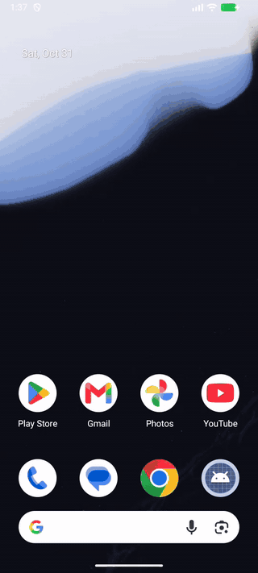
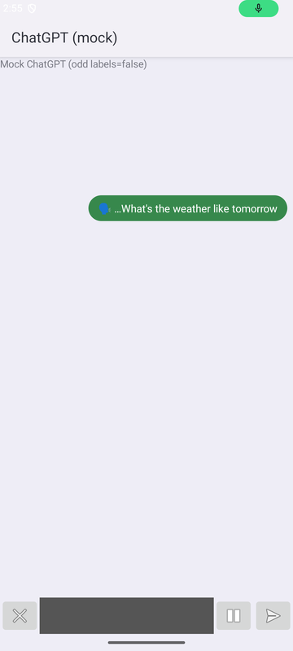
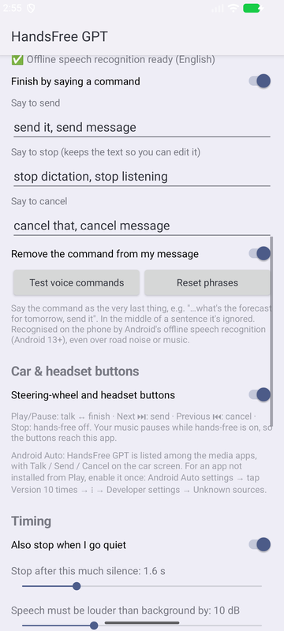
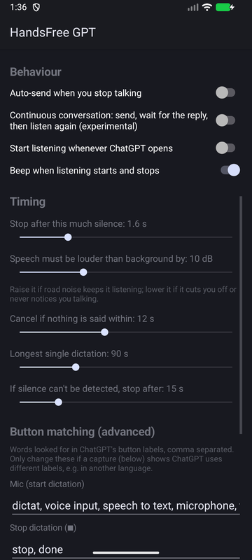
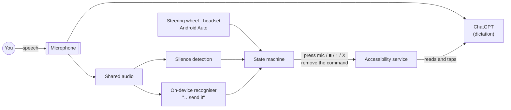

<p align="center">
  
</p>

<h1 align="center">HandsFree GPT</h1>

<p align="center">
  Hands-free dictation for the ChatGPT Android app: talk, then say "send it" or press the steering-wheel button.<br>
  No voice mode, so you keep the full text models.
</p>

<p align="center">
  <a href="https://github.com/WillPastor/handsfree-gpt/actions/workflows/ci.yml"></a>
  
  
  
  
  
</p>

---

ChatGPT's voice mode is convenient, but it runs on a separate, voice-tuned model. **Dictation** keeps you on
the regular models, with full reasoning and long answers. The catch is that it needs a tap to start and another
to stop, which doesn't work when your hands are on the steering wheel.

**HandsFree GPT does the tapping.** It starts ChatGPT's dictation, then finishes it in whichever of these
happens first:

- **You say a command at the end**, such as "…what's the forecast for tomorrow, *send it*". It's recognised
  offline on the phone, works over road noise, music or passengers, and is removed from your message.
- **You press a steering-wheel or headset button**: ⏭ sends, ⏮ cancels. It also works from Android Auto's
  media screen.
- **You stop talking** (optional silence detection).

> **Status: v0.3.0.** Works with the live ChatGPT app on a Samsung Galaxy S26 Ultra running Android 16: dictation
> and the "send it" voice command since v0.2.1, and reading replies aloud since v0.3.0. The steering-wheel buttons
> and Android Auto haven't been tried in a car yet. Every change is also tested end to end on an emulator against
> a mock ChatGPT. See [Limitations](#limitations).

## Demo

<table>
  <tr>
    <td align="center"><br><sub>Continuous mode loop</sub></td>
    <td align="center"><br><sub>Live words, before "send it"</sub></td>
    <td align="center"><br><sub>Voice &amp; car settings</sub></td>
    <td align="center"><br><sub>Settings (dark)</sub></td>
  </tr>
</table>

<sub>Recorded on an Android 16 emulator against <a href="mock-chatgpt">the mock ChatGPT</a> used by the end-to-end
tests. The live words come from Android's on-device recogniser hearing a synthesised recording.</sub>

## Features

- **Voice commands.** At the end of a dictation you can say:
  - "send it" or "send message" to send
  - "stop dictation" to keep the text so you can edit it
  - "cancel that" to discard it

  A command only counts as the last thing said, so "…send it to my boss" doesn't trigger it. Commands are
  removed from the message before it's sent, and the phrases are editable.
- **Steering-wheel, headset and Android Auto buttons.** Play/pause toggles talking and finishing, next sends,
  previous cancels. In Android Auto, HandsFree GPT is a media source with Talk, Send and Cancel buttons.
- **One-tap start** from the app, a Quick Settings tile, a launcher shortcut, "Hey Google, play HandsFree GPT",
  or any routine app via an intent.
- **Auto-send** and an experimental **continuous conversation** mode that sends, waits for the reply, then
  listens again. If nothing was sent, for example after you tap ChatGPT's own X, it pauses instead.
- **Replies read aloud.** When a reply finishes, the app presses ChatGPT's own Read aloud button and waits for it
  to finish before listening again. It never reads your chats itself. Play/pause pauses a reply, and next ⏭
  skips the rest. If you pause it in ChatGPT, the app waits for you, and turning hands-free off pauses it too.
- **Floating status pill** that shows the words as they're heard. Tap it to talk or stop, hold it to exit,
  drag to move it. It keeps the screen on.
- **Robust button finding.** Buttons are matched by accessibility label, with button position as a fallback.
  If a button can't be found, the app saves a capture of ChatGPT's layout so the matching can be fixed.
- **Private by design.** No internet permission, and recognition happens on the device. See [Privacy](#privacy).

## How it works

An Android **accessibility service** reads ChatGPT's screen and presses its buttons. The key trick is that
**Android 10+ lets an accessibility service record audio at the same time as the app on screen**. While
ChatGPT transcribes, HandsFree GPT taps the same audio for two things:
- an energy-based silence detector
- Android's own **on-device speech recogniser**, fed through a pipe, which spots spoken commands

A media session turns car and headset buttons into the same actions.



**[docs/architecture.md](docs/architecture.md)** covers:
- the state machine
- how the command matcher and "strip the command" step work
- media-button routing
- mic sharing

## Install

1. Install the APK from [Releases](../../releases), or [build it](#build-and-test). Allow installs from that
   source if asked.
2. Open **HandsFree GPT** and tap **Allow microphone**.
3. Tap **Accessibility settings** and turn on **HandsFree GPT**.
   > Android 13+ blocks accessibility services in sideloaded apps with a "Restricted setting" message. To allow
   > it: **App info** → ⋮ → **Allow restricted settings**, then turn the service on.
4. **Voice commands:** the settings screen shows whether offline speech recognition is ready. Use
   **Test voice commands** to check.
5. **Android Auto (optional):** Android Auto settings → tap **Version** 10 times → ⋮ → **Developer settings** →
   **Unknown sources**. HandsFree GPT then appears among the media apps.
6. Optional: add the **Hands-free GPT** tile to Quick Settings.

Requires Android 10+ and the [ChatGPT app](https://play.google.com/store/apps/details?id=com.openai.chatgpt).
Voice commands need Android 13+.

## Use

| To… | Say | Press | Or |
|---|---|---|---|
| Start talking | | Play/Pause | ▶ in the app, the tile, or tap the pill |
| Send | "…send it" | Next ⏭ | Stop talking (with auto-send on) |
| Stop and keep the text | "…stop dictation" | Play/Pause | Stop talking, or tap the pill |
| Cancel | "…cancel that" | Previous ⏮ | Say nothing for 12 s, or tap ChatGPT's own X |
| Pause or resume a reply being read aloud | | Play/Pause | Tap the pill, or use ChatGPT's own button |
| Skip a reply being read aloud, and talk | | Next ⏭ | |
| Stop a reply being read aloud, and wait | | Previous ⏮ | |
| Turn hands-free off | | Stop | Hold the pill, or tap the tile |

The settings cover:
- the voice-command phrases
- the silence length and sensitivity, or turning silence detection off for noisy cars
- timeouts, auto-send and continuous mode
- starting whenever ChatGPT opens
- beeps
- the words used to recognise ChatGPT's buttons

## Build and test

Needs JDK 17+ (Android Studio's bundled JDK works) and the Android SDK, platform 36.

```bash
./gradlew assembleDebug              # → app/build/outputs/apk/debug/app-debug.apk
./gradlew lint testDebugUnitTest     # Android Lint + unit tests
scripts/e2e.sh                       # end-to-end, on a running emulator (~8 min)
```

| Layer | What it checks |
|---|---|
| **Unit** (17 tests) | [`SpeechTrackerTest`](app/src/test/java/com/handsfreegpt/SpeechTrackerTest.kt) runs silence detection on synthetic audio: road noise, pauses, rising noise, timeouts. [`VoiceCommandsTest`](app/src/test/java/com/handsfreegpt/VoiceCommandsTest.kt) checks that commands fire only at the end and how the command is stripped from the text |
| **End to end** ([`scripts/e2e.sh`](scripts/e2e.sh), 82 checks) | Runs on an emulator against [`mock-chatgpt`](mock-chatgpt), a test double that holds the mic, takes time to transcribe and can read replies aloud, like the real app. Covers: start, auto-cancel, tap to stop, the position fallback, long-press exit, the tile, **media buttons**, a **spoken "…send it"** replayed into Android's on-device recogniser, which must send the message without the command (even when the message itself ends in "send it"), a send that doesn't go through, which must not be reported as sent, dictations ended with ChatGPT's own X, ■ or ↑, or with nothing in them, where only a message ChatGPT took may count as sent, even one whose reply is over within half a second, and **reading replies aloud**: pausing a reply in ChatGPT or with play/pause, stopping or skipping it, even before ChatGPT starts speaking, and turning hands-free off mid-reply. Replies mention "stop" and "done", which must never pass for buttons, and captures must leave out chat text |
| **CI** ([GitHub Actions](.github/workflows/ci.yml)) | Lint, unit tests and both APKs on every push |

## Project structure

```
app/                       the app
  src/main/java/com/handsfreegpt/
    HandsFreeService.kt      accessibility service: reads/taps ChatGPT, hosts the overlay
    DictationController.kt   the hands-free state machine
    ChatGptUi.kt             accessibility tree → Snapshot (buttons, text box, state), clicks, captures
    SpeechEndDetector.kt     shared-mic capture → silence detection + audio for the recogniser
    SpeechTracker.kt         speech / silence decisions (pure Kotlin)
    VoiceCommands.kt         command matcher + removing the command from the text (pure Kotlin)
    VoiceCommandRecognizer.kt  Android's on-device recogniser, fed through a pipe
    MediaControls.kt         media session: steering-wheel / headset / Android Auto buttons
    HandsFreeMediaBrowser.kt Android Auto media source
    StatusOverlay.kt         floating status pill
    HandsFreeTileService.kt  Quick Settings tile
    MainActivity.kt          setup & settings screen, START/STOP intents
    Prefs.kt                 settings
  src/debug/                 test-only: replay a recording into voice commands
  src/test/…                 unit tests
mock-chatgpt/              test double for end-to-end tests (never ship it)
scripts/e2e.sh             end-to-end test runner
docs/                      architecture notes and images
```

## Roadmap

Each planned feature has its own [issue](../../issues) with the details.

- [ ] A wake phrase to *start* talking without a button ([#4](../../issues/4))
- [ ] Translate the app ([#5](../../issues/5))
- [ ] Prepare for a Google Play release ([#6](../../issues/6))
- [ ] A new name without "GPT" ([#7](../../issues/7))
- [ ] Try the steering-wheel buttons and Android Auto in a car ([#9](../../issues/9))
- [x] ~~Read replies aloud~~: shipped in v0.3.0 and checked on a real phone ([#3](../../issues/3))
- [x] ~~Verify against the live ChatGPT app~~: dictation and "send it" checked on a real phone for v0.2.1
- [x] ~~Android Auto controller~~: shipped in v0.2.0 as a media source with Talk / Send / Cancel
- [x] ~~Steering-wheel media buttons~~: shipped in v0.2.0

## Limitations

- The phone has to be **unlocked with ChatGPT on screen**, because accessibility services can only press
  visible buttons. The pill keeps the screen on while hands-free is active.
- It depends on ChatGPT's UI. An app update can rename or move buttons. Captures and editable button words
  make that a quick fix rather than a code change.
- Voice commands need **Android 13+** and Android's offline speech recognition for your language. The app
  shows whether it's ready and can trigger the download.
- **Your music pauses while hands-free is on.** That's how the car's buttons reach the app, and it keeps the
  music out of your dictation.
- If Android won't share the microphone, as happens with some privacy-sensitive recordings, the app falls back
  to a timer. You can still use the buttons or tap the pill.

## Privacy

- No `INTERNET` permission, so the app can't send anything anywhere.
- Audio is analysed 20 ms at a time in memory and never recorded or stored.
- Voice commands use Android's **on-device** recogniser only; the app never falls back to a cloud service.
- The accessibility service only acts on the ChatGPT app. It subscribes to content changes only while
  hands-free is on.
- UI captures leave out chat text, stay in app-private storage, and are shared only if you tap **Share**.
- Backups include only the settings.

## Disclaimer

This is an independent project. It isn't affiliated with, endorsed by, or sponsored by OpenAI.
"ChatGPT" is a trademark of OpenAI. HandsFree GPT uses Android's accessibility APIs to operate an app on your
own device, at your request.

## License

[MIT](LICENSE) © 2026 Will Pastor
