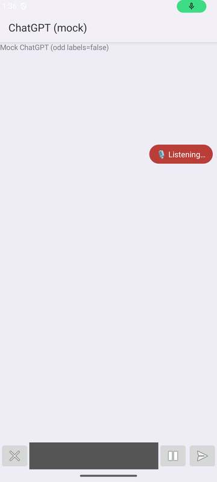
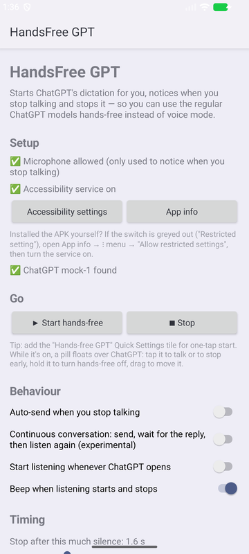
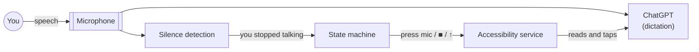

<p align="center">
  
</p>

<h1 align="center">HandsFree GPT</h1>

<p align="center">
  Hands-free dictation for the ChatGPT Android app: start talking, pause, and it sends.<br>
  No voice mode, so you keep the full text models.
</p>

<p align="center">
  
  
  
  
  
</p>

---

ChatGPT's voice mode is convenient, but it runs on a separate, voice-tuned model. **Dictation** keeps you on
the regular models, with full reasoning and long answers. The catch is that it needs a tap to start and another
to stop, which doesn't work when your hands are on the steering wheel.

**HandsFree GPT does the tapping.** It starts ChatGPT's dictation and listens for the moment you stop talking.
Then it stops the dictation (■) or sends it (↑). Optionally, it waits for the reply and listens again.

> **Status: MVP (v0.1.0).** Tested end to end on an emulator against a mock ChatGPT. It hasn't yet been
> validated against the live ChatGPT app. See [Limitations](#limitations).

## Demo

<table>
  <tr>
    <td align="center"><br><sub>Continuous mode loop</sub></td>
    <td align="center"><br><sub>Listening</sub></td>
    <td align="center"><br><sub>Setup</sub></td>
    <td align="center"><br><sub>Settings (dark)</sub></td>
  </tr>
</table>

<sub>Recorded on an Android 16 emulator against <a href="mock-chatgpt">the mock ChatGPT</a> used by the end-to-end
tests. The emulator has no voice input, so a tap on the pill stands in for "you stopped talking".</sub>

## Features

- **One-tap start** from the app, a Quick Settings tile, a launcher shortcut, or any routine app (via an intent).
  ChatGPT opens, you hear a beep, and dictation starts.
- **Stops when you stop talking.** It detects silence against an adaptive noise floor tuned for road noise.
- **Auto-send** and an experimental **continuous conversation** mode that sends, waits for the reply, then
  listens again.
- **Floating status pill.** Tap to talk or stop early, hold to exit, drag to move it. It keeps the screen on.
- **Robust button finding.** Buttons are matched by accessibility label first and by position as a fallback.
  When something isn't found, it saves a capture of ChatGPT's layout so the matching can be fixed.
- **Private by design.** There's no internet permission and audio never leaves memory.
  See [Privacy](#privacy).

## How it works

An Android **accessibility service** reads ChatGPT's screen and presses its buttons. The key trick is that
**Android 10+ lets an accessibility service record audio at the same time as the app on screen**. ChatGPT keeps
transcribing while HandsFree GPT measures loudness to tell when you've finished.



The state machine, button-finding rules, voice activity detection and mic sharing are covered in
**[docs/architecture.md](docs/architecture.md)**.

## Install

1. Install the APK from [Releases](../../releases), or [build it](#build-and-test). Allow installs from that
   source if asked.
2. Open **HandsFree GPT** and tap **Allow microphone**.
3. Tap **Accessibility settings** and turn on **HandsFree GPT**.
   > Android 13+ blocks accessibility services in sideloaded apps with a "Restricted setting" message. To allow
   > it: **App info** → ⋮ → **Allow restricted settings**, then turn the service on.
4. Optional: add the **Hands-free GPT** tile to Quick Settings.

Requires Android 10+ and the [ChatGPT app](https://play.google.com/store/apps/details?id=com.openai.chatgpt).

## Use

| To… | Do this |
|---|---|
| Start | **▶ Start hands-free**, the Quick Settings tile, or long-press the app icon → *Start hands-free* |
| Finish early | Tap the pill |
| Talk again | Tap the pill |
| Turn it off | Hold the pill, tap the tile, or press **■ Stop** |
| Automate | Launch `com.handsfreegpt.MainActivity` with action `com.handsfreegpt.action.START` or `…STOP` |

The settings cover the silence length, speech sensitivity, timeouts, auto-send, continuous mode, starting
whenever ChatGPT opens, beeps, and the words used to recognise ChatGPT's buttons.

## Build and test

Needs JDK 17+ (Android Studio's bundled JDK works) and the Android SDK, platform 36.

```bash
./gradlew assembleDebug              # → app/build/outputs/apk/debug/app-debug.apk
./gradlew lint testDebugUnitTest     # Android Lint + unit tests
scripts/e2e.sh                       # end-to-end, on a running emulator (~90 s)
```

| Layer | What it checks |
|---|---|
| **Unit** ([`SpeechTrackerTest`](app/src/test/java/com/handsfreegpt/SpeechTrackerTest.kt)) | Silence detection on synthetic audio: quiet rooms, road noise, mid-sentence pauses, rising background noise, timeouts |
| **End to end** ([`scripts/e2e.sh`](scripts/e2e.sh)) | 16 checks on an emulator against [`mock-chatgpt`](mock-chatgpt), a test double with ChatGPT's composer and dictation bar that holds the mic like the real app. It covers start, auto-cancel, tap-to-stop, the position fallback, long-press exit, the tile, and that ChatGPT keeps its mic while both apps listen |
| **CI** ([GitHub Actions](.github/workflows/ci.yml)) | Lint, unit tests and both APKs on every push |

## Project structure

```
app/                      the app
  src/main/java/com/handsfreegpt/
    HandsFreeService.kt     accessibility service: reads/taps ChatGPT, hosts the overlay
    DictationController.kt  the hands-free state machine
    ChatGptUi.kt            accessibility tree → Snapshot (buttons + state), clicks, captures
    SpeechEndDetector.kt    shared-mic capture → loudness
    SpeechTracker.kt        speech / silence decisions (pure Kotlin)
    StatusOverlay.kt        floating status pill
    HandsFreeTileService.kt Quick Settings tile
    MainActivity.kt         setup & settings screen, START/STOP intents
    Prefs.kt                settings
  src/test/…                unit tests
mock-chatgpt/             test double for end-to-end tests (never ship it)
scripts/e2e.sh            end-to-end test runner
docs/                     architecture notes and images
```

## Roadmap

- [ ] Verify button labels against the live ChatGPT app, using a capture from a real device
- [ ] Read replies aloud, then listen again, for a complete in-car loop
- [ ] **Android Auto controller**: big Talk / Stop / Send / Cancel buttons on the car screen (Car App Library)
- [ ] Steering-wheel media buttons for talk and stop
- [ ] Localised UI strings

## Limitations

- The phone has to be **unlocked with ChatGPT on screen**, because accessibility services can only press
  visible buttons. The pill keeps the screen on while hands-free is active.
- It depends on ChatGPT's UI. An app update can rename or move buttons. Captures and editable button words
  make that a quick fix rather than a code change.
- If Android won't share the microphone, as happens with some privacy-sensitive recordings, the app falls back
  to a timer. You can still tap the pill to stop.

## Privacy

- No `INTERNET` permission, so the app can't send anything anywhere.
- Audio is analysed 20 ms at a time in memory and immediately discarded. Nothing is recorded or stored.
- The accessibility service only acts on the ChatGPT app. It subscribes to content changes only while
  hands-free is on.
- UI captures leave out chat text, stay in app-private storage, and are shared only if you tap **Share**.
- Backups include only the settings.

## Disclaimer

This is an independent project. It isn't affiliated with, endorsed by, or sponsored by OpenAI.
"ChatGPT" is a trademark of OpenAI. HandsFree GPT uses Android's accessibility APIs to operate an app on your
own device, at your request.

## License

[MIT](LICENSE) © 2026 Will Pastor
