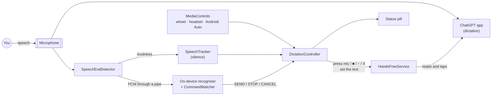
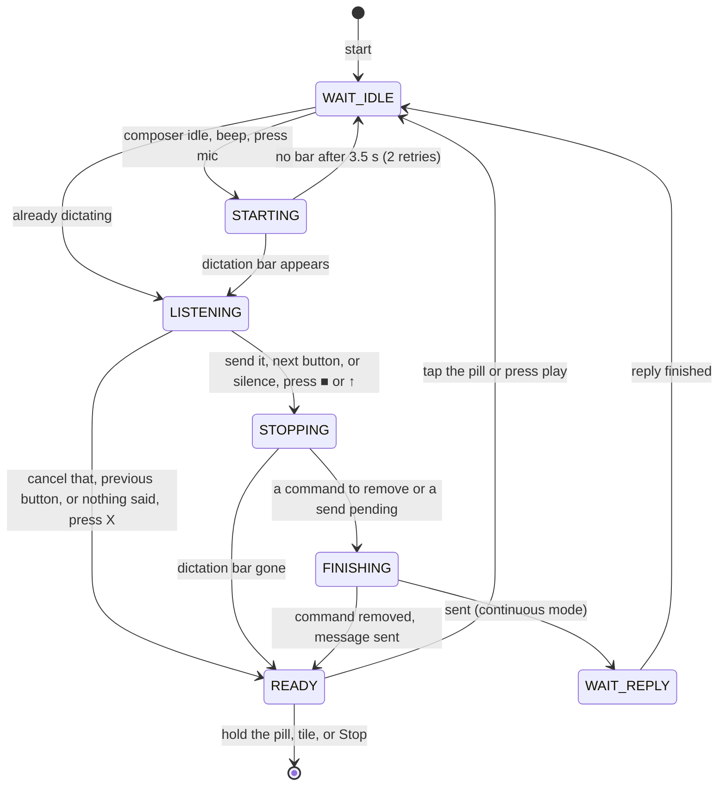

# Architecture

HandsFree GPT is a single-module Android app in Kotlin with **no runtime dependencies**. Everything is built
on platform APIs:
- an accessibility service
- `AudioRecord`
- `SpeechRecognizer`
- `MediaSession`
- plain Views

## Components

| Class | Responsibility |
|---|---|
| [`HandsFreeService`](../app/src/main/java/com/handsfreegpt/HandsFreeService.kt) | The `AccessibilityService`, and the app's only privileged component. It reads ChatGPT's window, performs clicks and gestures, and hosts the overlay. |
| [`DictationController`](../app/src/main/java/com/handsfreegpt/DictationController.kt) | The state machine, run by a 250 ms tick while a session is active. Every control uses its entry points `startSession`, `toggleListening`, `sendNow`, `cancelNow` and `endSession`. |
| [`ChatGptUi`](../app/src/main/java/com/handsfreegpt/ChatGptUi.kt) | Turns ChatGPT's accessibility tree into a `Snapshot`: the buttons, the composer's text box, and whether it's idle, dictating or generating. It also clicks, sets the composer text, and writes the diagnostic UI captures. |
| [`SpeechEndDetector`](../app/src/main/java/com/handsfreegpt/SpeechEndDetector.kt) | Shares the microphone and splits each 20 ms frame two ways: loudness goes to `SpeechTracker`, and the raw audio goes to the command recogniser. |
| [`SpeechTracker`](../app/src/main/java/com/handsfreegpt/SpeechTracker.kt) | Pure Kotlin that decides whether you're talking and when you've gone quiet. Unit-tested. |
| [`VoiceCommands`](../app/src/main/java/com/handsfreegpt/VoiceCommands.kt) | Pure Kotlin `CommandMatcher`, which spots "…send it" at the very end of what you said, plus `stripTrailingCommand`. Unit-tested. |
| [`VoiceCommandRecognizer`](../app/src/main/java/com/handsfreegpt/VoiceCommandRecognizer.kt) | Android's **on-device** `SpeechRecognizer`, fed our audio through a pipe. It sits behind a small `CommandRecognizer` interface and needs Android 13+. |
| [`MediaControls`](../app/src/main/java/com/handsfreegpt/MediaControls.kt), [`HandsFreeMediaBrowser`](../app/src/main/java/com/handsfreegpt/HandsFreeMediaBrowser.kt) | The media session behind steering-wheel, headset and Android Auto buttons, and the Android Auto media source. |
| [`StatusOverlay`](../app/src/main/java/com/handsfreegpt/StatusOverlay.kt) | The floating pill: a `TYPE_ACCESSIBILITY_OVERLAY` window that also keeps the screen on. |
| [`HandsFreeTileService`](../app/src/main/java/com/handsfreegpt/HandsFreeTileService.kt), [`MainActivity`](../app/src/main/java/com/handsfreegpt/MainActivity.kt) | Quick Settings tile, setup and settings screen, launcher shortcuts, `START`/`STOP` intents, and play-from-search. |
| [`Prefs`](../app/src/main/java/com/handsfreegpt/Prefs.kt) | Settings backed by SharedPreferences, exposed through property delegates. |

## The dictation loop

Each tick reads a fresh `Snapshot` of ChatGPT's screen and decides what to do next. Because of that, the
controller copes with missed events, with you tapping things yourself, and with ChatGPT acting on its own.

When a button can't be found or a step times out, the app saves a UI capture, shows the problem in amber on
the pill, and goes back to `READY`.

## Reading ChatGPT's screen

- **Only the lower 60% of the window** is searched. The composer lives there, even with the keyboard up, so a
  word like "stop" or "send" inside a chat message is never mistaken for a button.
- **Every label gets one role**, checked in priority order: cancel → stop → send → voice mode → mic. That way
  "Stop dictation" can never be read as the mic.
- **State comes from which buttons are present:**
  - *dictating*: a stop button and no mic, or the X is present.
  - *generating*: a stop button next to the mic.
  - *idle*: a mic and no stop button.
- **The composer's text box** is the lowest editable node. A placeholder isn't treated as text: empty fields
  report their hint as text, so `isShowingHintText` is checked.
- **Position fallback for unknown labels.** The mic is the button just left of the voice-mode button. ■ and ↑
  are the last two buttons in the same row as a recognised X. The fallback must be anchored on the X, because a
  composer holding text (`[+] … [mic] [send]`) has exactly the same shape as the dictation bar
  (`[X] … [■] [↑]`). End-to-end scenario 3 guards this.
- **It waits for the UI to settle.** The mic is only pressed once its bounds are the same on two consecutive
  ticks.
- **Clicking** uses `ACTION_CLICK` on the node, or on a clickable ancestor at most 4× its size. Otherwise it
  sends a real tap through `dispatchGesture`.

## Sharing the microphone

ChatGPT is recording while it dictates, so HandsFree GPT has to listen at the same time. Android 10+ supports
this: its [concurrent-capture policy](https://developer.android.com/media/platform/sharing-audio-input) lets an
enabled accessibility service capture alongside the app in the foreground.

HandsFree GPT records with the `VOICE_RECOGNITION` source at 16 kHz mono. If the platform silences it anyway,
the app notices: `isClientSilenced()` reports it, or the samples come back as pure digital zeros. In that case
it falls back to a timer, and the buttons and the pill still work.

On an Android 16 emulator, the mock ChatGPT's own recording reported `isClientSilenced=false` the whole time
HandsFree GPT was listening alongside it.

## Finishing a dictation

### Voice commands

- **The recogniser.** [`VoiceCommandRecognizer`](../app/src/main/java/com/handsfreegpt/VoiceCommandRecognizer.kt)
  hands the shared audio to Android's own `SpeechRecognizer` through a `ParcelFileDescriptor` pipe
  (`EXTRA_AUDIO_SOURCE`, Android 13).
  - **No extra capture.** It never opens a second microphone stream.
  - **Never blocks capture.** A bounded queue and a writer thread drop audio rather than stall the capture loop.
  - **On-device only.** It uses `createOnDeviceSpeechRecognizer` exclusively. When that's unavailable, voice
    commands are switched off rather than falling back to a cloud recogniser.
- **Continuous recognition.** It asks for a *segmented session* (`EXTRA_SEGMENTED_SESSION`) with partial
  results. Recognisers that ignore segmented mode are simply restarted after each utterance.
- **Status in settings.** The settings screen shows whether the phone's language is installed for offline
  recognition (`checkRecognitionSupport`) and can trigger the download (`triggerModelDownload`). The
  **Test voice commands** dialog shows what the recogniser hears.
- **Matching** ([`CommandMatcher`](../app/src/main/java/com/handsfreegpt/VoiceCommands.kt)):
  - **Normalising.** Transcripts are lowercased and punctuation is dropped.
  - **Only at the very end.** A command matches only when the transcript *ends* with the phrase, on a word
    boundary.
  - **Firing.** A partial result arms the command. It fires after 0.7 s with no further words, or immediately
    when the recogniser closes the segment. More words disarm it, so "…send it to my boss" never fires.
  - **Specificity.** The longest phrase wins, and a command fires once per dictation.
- **Removing the command.** ChatGPT transcribes the command too, so a voice command presses **■, not ↑**.
  `FINISHING` then:
  - **Waits for the transcript itself.** ChatGPT can bring back its text box, send arrow included, before the
    transcript is in it ([#1](https://github.com/WillPastor/handsfree-gpt/issues/1)). So it waits for text that
    wasn't there when the mic was pressed, has stopped changing for a tick, and that ChatGPT's send arrow is
    enabled for. It gives up after 20 s.
  - **Strips.** `stripTrailingCommand` turns "What's the forecast? Send it." into "What's the forecast?".
  - **Sets the text** with `ACTION_SET_TEXT`. The text without the command is worked out once, and later ticks
    only check that the edit took, so a message that itself ends in "send it" keeps it.
  - **Sends or keeps.** For "send it" it presses send; for "stop dictation" it leaves the text for editing.
  - **Checks it went.** "Sent" only shows once the text box empties or a reply starts. If neither happens within
    3 s it presses send once more, then shows "Couldn't send" in amber.
- **Racing silence detection.** If silence detection fires first, the controller waits 1.2 s, so a command
  still being recognised can win. Silence auto-stop can also be switched off for noisy cars.

### Car and headset buttons

- **Claiming the buttons.** Android routes media buttons to the app that is **playing audio**. While hands-free
  is on, [`MediaControls`](../app/src/main/java/com/handsfreegpt/MediaControls.kt) loops a silent `AudioTrack`
  and holds transient audio focus. That also pauses music, which keeps it out of the dictation. Its
  `MediaSession` maps:

  | Button | Action |
  |---|---|
  | Play/Pause, headset button | `toggleListening` |
  | Next | `sendNow` |
  | Previous | `cancelNow` |
  | Stop | `endSession` |
- **Status on the car display.** The status text is published as the track title, so Bluetooth car displays
  show "Listening…".
- **Android Auto** gives the wheel buttons to the media app on its screen, so
  [`HandsFreeMediaBrowser`](../app/src/main/java/com/handsfreegpt/HandsFreeMediaBrowser.kt) lists the app as a
  media source.
  - **What you see.** One playable item, plus Send and Cancel as custom actions on the now-playing screen.
  - **Starting.** Play starts hands-free, as does "Hey Google, play HandsFree GPT" via play-from-search.
  - **No resume controls.** System UI's "resume playback" connection is refused, because there's nothing to
    resume.

### Knowing when a reply has finished (continuous mode)

While a reply streams, ChatGPT shows a stop button next to the mic (*generating*). The controller waits until
the composer is idle again **and** the window content hasn't changed for 1.5 s, because streaming text changes
it constantly. Then it starts the next dictation.

## Testing

| Layer | Covers | How |
|---|---|---|
| Unit | `SpeechTracker`, `CommandMatcher`, `stripTrailingCommand` | JUnit with synthetic loudness traces and transcripts (17 tests). |
| End to end | The whole app against [`mock-chatgpt`](../mock-chatgpt) | [`scripts/e2e.sh`](../scripts/e2e.sh) on an emulator, asserting on logcat from both apps (29 checks). |
| Static | Android Lint | `./gradlew lint`, with zero issues in both modules. |
| CI | All of the above except the emulator run | [GitHub Actions](../.github/workflows/ci.yml). |

- **Media buttons** are tested with `adb shell input keyevent KEYCODE_MEDIA_*`.
- **Voice commands** are tested end to end with real recognition:
  - **Debug-only replay.** A receiver in `app/src/debug` queues a recording (`send-it.pcm`, made with Windows
    speech synthesis), which the next dictation plays instead of the microphone.
  - **Real recogniser.** Android System Intelligence on the emulator recognises the clip.
  - **The check.** The mock must receive "Hello from dictation." with "Send it" removed. A second scenario
    sets the transcript to "Repeat the words send it. Send it." and expects only the last "Send it" removed.

`mock-chatgpt` is a test double that reuses ChatGPT's package name:
- It reproduces the composer and dictation bar, with real content descriptions.
- It holds the microphone while "dictating", inserts a transcript that includes the spoken command, and streams
  a fake reply.
- Transcribing takes it 2 s. As the real app appears to, it brings its text box back first, with the send arrow
  showing but disabled.
- Its *odd labels* mode renames or removes labels to exercise the position fallback. Its *ignore send* mode
  makes the send arrow do nothing, to test that the app says so instead of "Sent". What its dictations
  transcribe to can be set too.

## Design choices

- **No dependencies, platform Views.** The APK is small, there's nothing to keep updated and builds are fast.
  `androidx.annotation` is used `compileOnly`, purely so lint can enforce `@RequiresApi(33)` at every call site.
- **Polling plus events.** A 250 ms tick re-reads the tree from scratch, so a missed event can't wedge the loop.
  When no session is active, the service only listens for window-state events.
- **One thread for logic.** Everything runs on the main thread except the audio loop and the pipe writer.
  Audio results carry a generation counter, so a stopped detector can't deliver a late result.
- **Swappable recogniser.** Voice commands sit behind `CommandRecognizer`, so a bundled offline recogniser could
  replace the platform one on phones without on-device recognition.
- **Privacy by construction.**
  - There is no `INTERNET` permission, and recognition is on-device only.
  - Audio never leaves memory.
  - Captures redact chat text.
  - Backups include only the settings.
