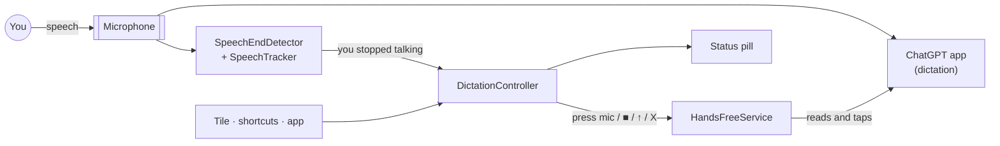
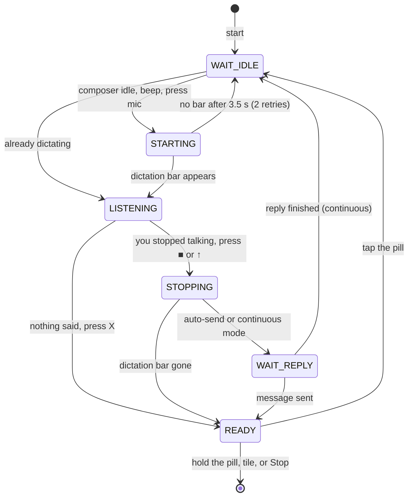

# Architecture

HandsFree GPT is a single-module Android app in Kotlin with **no runtime dependencies**. Everything is
built on platform APIs: an accessibility service, `AudioRecord` and plain Views.

## Components

| Class | Responsibility |
|---|---|
| [`HandsFreeService`](../app/src/main/java/com/handsfreegpt/HandsFreeService.kt) | The `AccessibilityService`, and the app's only privileged component. It reads ChatGPT's window, performs clicks and gestures, and hosts the overlay. It forwards events to the controller. |
| [`DictationController`](../app/src/main/java/com/handsfreegpt/DictationController.kt) | The state machine, run by a 250 ms tick while a session is active. `startSession`, `toggleListening` and `endSession` are the only entry points, and every control surface uses them. |
| [`ChatGptUi`](../app/src/main/java/com/handsfreegpt/ChatGptUi.kt) | Turns ChatGPT's accessibility tree into a `Snapshot`: which buttons are present and whether the composer is idle, dictating or generating. It also clicks, and writes the diagnostic UI captures. |
| [`SpeechEndDetector`](../app/src/main/java/com/handsfreegpt/SpeechEndDetector.kt) | Audio plumbing: shares the microphone, turns 20 ms PCM frames into loudness, and notices when the platform silences it. |
| [`SpeechTracker`](../app/src/main/java/com/handsfreegpt/SpeechTracker.kt) | Pure Kotlin that decides whether you're talking and when you've finished. It is unit-tested. |
| [`StatusOverlay`](../app/src/main/java/com/handsfreegpt/StatusOverlay.kt) | The floating pill: a `TYPE_ACCESSIBILITY_OVERLAY` window that also keeps the screen on. |
| [`HandsFreeTileService`](../app/src/main/java/com/handsfreegpt/HandsFreeTileService.kt), [`MainActivity`](../app/src/main/java/com/handsfreegpt/MainActivity.kt) | Control surfaces: the Quick Settings tile, the setup and settings screen, launcher shortcuts and `START`/`STOP` intents. |
| [`Prefs`](../app/src/main/java/com/handsfreegpt/Prefs.kt) | Settings backed by SharedPreferences, exposed through property delegates. |

## The dictation loop

Each tick reads a fresh `Snapshot` of ChatGPT's screen and decides what to do next. Because of that, the
controller copes with missed events, with you tapping things yourself, and with ChatGPT acting on its own,
for example sending a dictation by itself.

When a button can't be found or a step times out, the app saves a UI capture, shows the problem in amber on
the pill, and goes back to `READY`.

## Reading ChatGPT's screen

- **Only the lower 60% of the window** is searched. The composer lives there, even with the keyboard up, so a
  word like "stop" or "send" inside a chat message is never mistaken for a button.
- **Every label gets one role**, checked in priority order: cancel → stop → send → voice mode → mic. That way
  "Stop dictation" can never be read as the mic. If two buttons match the same role, the lowest one wins.
- **State comes from which buttons are present:**
  - *dictating*: a stop button and no mic, or the X is present.
  - *generating*: a stop button next to the mic.
  - *idle*: a mic and no stop button.
- **Position fallback for unknown labels.** The mic is the button just left of the voice-mode button. ■ and ↑
  are the last two buttons in the same row as a recognised X. The fallback must be anchored on the X, because a
  composer holding text (`[+] … [mic] [send]`) has exactly the same shape as the dictation bar
  (`[X] … [■] [↑]`). Scenario 3 of the end-to-end test guards against mixing them up.
- **It waits for the UI to settle.** The mic is only pressed once its bounds are the same on two consecutive
  ticks, because ChatGPT may still be animating in.
- **Clicking** uses `ACTION_CLICK` on the node, or on a clickable ancestor at most 4× its size so a whole
  container is never clicked. Otherwise it sends a real tap through `dispatchGesture`.
- **Diagnostics:** a capture is a text dump of ChatGPT's accessibility tree, with labels, bounds and flags.
  Long chat text is redacted. It's what you need to adapt the matching after a ChatGPT update.

## Knowing when you've stopped talking

### Sharing the microphone

ChatGPT is recording while it dictates, so HandsFree GPT has to listen at the same time. Android 10+ supports
this: its [concurrent-capture policy](https://developer.android.com/media/platform/sharing-audio-input) lets an
enabled accessibility service capture alongside the app in the foreground.

HandsFree GPT records with the `VOICE_RECOGNITION` source, the one the policy is most lenient with for
accessibility services, at 16 kHz mono, and only computes loudness. If the platform silences it anyway, the app
notices: `AudioRecordingConfiguration.isClientSilenced()` reports it, or the samples come back as pure digital
zeros. In that case it falls back to a fixed timer, and you can still tap the pill to stop.

On an Android 16 emulator, the mock ChatGPT's own recording reported `isClientSilenced=false` the whole time
HandsFree GPT was listening alongside it.

### `SpeechTracker`

| Step | Rule |
|---|---|
| Frames | 20 ms of PCM is converted to loudness in dBFS. |
| Noise floor | Starts as the quietest frame of the first 300 ms. It then **falls fast** (α = 0.15) during pauses and **rises slowly** (α = 0.03). Steady road noise becomes background, and speech that began before listening started is still caught at the first pause. |
| Speech frame | Louder than the floor by the sensitivity setting (default 10 dB) and above −58 dBFS. While you're talking, the threshold drops 3 dB (hysteresis). |
| Started talking | At least 200 ms of speech in one burst, so clicks and bumps don't count. |
| Finished | `silenceMs` of silence after speech (default 1.6 s). Also ends if nothing is said for 12 s (the dictation is cancelled) or after 90 s. |

[`SpeechTrackerTest`](../app/src/test/java/com/handsfreegpt/SpeechTrackerTest.kt) feeds it synthetic loudness
traces:
- a quiet room
- road noise only 14 dB below speech
- talking before the floor is known
- a 1.2 s pause mid-sentence
- background noise that gets 8 dB louder
- silence
- non-stop talking

### Knowing when a reply has finished (continuous mode)

While a reply streams, ChatGPT shows a stop button next to the mic (*generating*). The controller waits until
the composer is idle again **and** the window content hasn't changed for 1.5 s, because streaming text changes
it constantly. Then it starts the next dictation. The service only subscribes to content-change events while a
session is running.

## Testing

| Layer | Covers | How |
|---|---|---|
| Unit | `SpeechTracker` | JUnit with synthetic loudness traces (7 scenarios). |
| End to end | The whole app against [`mock-chatgpt`](../mock-chatgpt) | [`scripts/e2e.sh`](../scripts/e2e.sh) on an emulator, asserting on logcat from both apps (16 checks). |
| Static | Android Lint | `./gradlew lint`, with zero issues in `:app`. |
| CI | All of the above except the emulator run | [GitHub Actions](../.github/workflows/ci.yml). |

`mock-chatgpt` is a test double that reuses ChatGPT's package name. It reproduces the composer and dictation bar
with real content descriptions, holds the microphone while "dictating", and streams a fake reply. Its
*odd labels* mode renames or removes labels to exercise the position fallback.

## Design choices

- **No dependencies, platform Views.** The APK is small, there's nothing to keep updated and builds are fast.
  The only UI is a settings screen.
- **Polling plus events.** A 250 ms tick re-reads the tree from scratch, so a missed event can't wedge the loop.
  When no session is active, the service only listens for window-state events.
- **One thread for logic.** Everything runs on the main thread except the audio loop. Its results are tagged
  with a generation counter, so a detector that has already been stopped can't deliver a late result.
- **Privacy by construction.**
  - There is no `INTERNET` permission.
  - Audio never leaves memory.
  - Captures redact chat text.
  - Backups include only the settings.
