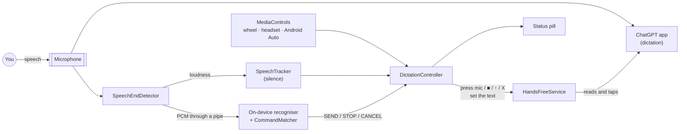
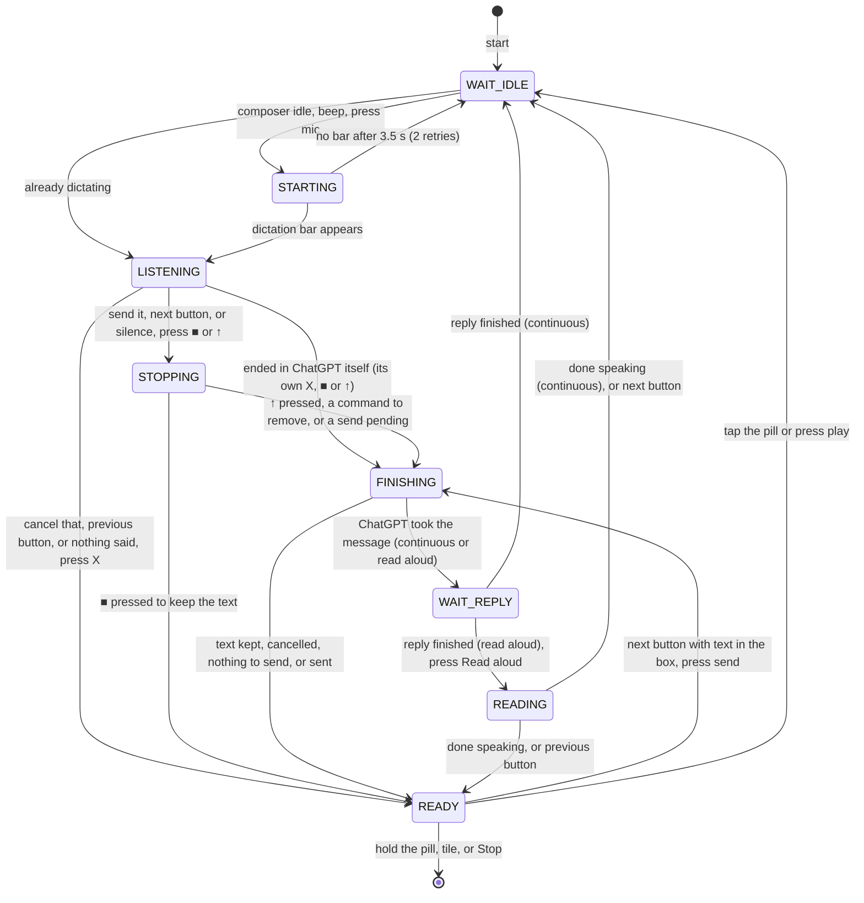

# Architecture

HandsFree GPT is a single-module Android app in Kotlin with **no runtime dependencies**. Everything is built
on platform APIs:
- an accessibility service
- `AudioRecord`
- `SpeechRecognizer`
- `MediaSession`
- plain Views

## Components

| Class | Responsibility |
|---|---|
| [`HandsFreeService`](../app/src/main/java/com/handsfreegpt/HandsFreeService.kt) | The `AccessibilityService`, and the app's only privileged component. It reads ChatGPT's window, performs clicks and gestures, and hosts the overlay. |
| [`DictationController`](../app/src/main/java/com/handsfreegpt/DictationController.kt) | The state machine, run by a 250 ms tick while a session is active. Every control uses its entry points `startSession`, `toggleListening`, `sendNow`, `cancelNow` and `endSession`. |
| [`ChatGptUi`](../app/src/main/java/com/handsfreegpt/ChatGptUi.kt) | Turns ChatGPT's accessibility tree into a `Snapshot`: the buttons, the composer's text box, and whether it's idle, dictating or generating. It also clicks, sets the composer text, and writes the diagnostic UI captures. |
| [`SpeechEndDetector`](../app/src/main/java/com/handsfreegpt/SpeechEndDetector.kt) | Shares the microphone and splits each 20 ms frame two ways: loudness goes to `SpeechTracker`, and the raw audio goes to the command recogniser. |
| [`SpeechTracker`](../app/src/main/java/com/handsfreegpt/SpeechTracker.kt) | Pure Kotlin that decides whether you're talking and when you've gone quiet. Unit-tested. |
| [`VoiceCommands`](../app/src/main/java/com/handsfreegpt/VoiceCommands.kt) | Pure Kotlin `CommandMatcher`, which spots "…send it" at the very end of what you said, plus `stripTrailingCommand`. Unit-tested. |
| [`VoiceCommandRecognizer`](../app/src/main/java/com/handsfreegpt/VoiceCommandRecognizer.kt) | Android's **on-device** `SpeechRecognizer`, fed our audio through a pipe. It sits behind a small `CommandRecognizer` interface and needs Android 13+. |
| [`MediaControls`](../app/src/main/java/com/handsfreegpt/MediaControls.kt), [`HandsFreeMediaBrowser`](../app/src/main/java/com/handsfreegpt/HandsFreeMediaBrowser.kt) | The media session behind steering-wheel, headset and Android Auto buttons, and the Android Auto media source. |
| [`StatusOverlay`](../app/src/main/java/com/handsfreegpt/StatusOverlay.kt) | The floating pill: a `TYPE_ACCESSIBILITY_OVERLAY` window that also keeps the screen on. |
| [`HandsFreeTileService`](../app/src/main/java/com/handsfreegpt/HandsFreeTileService.kt), [`MainActivity`](../app/src/main/java/com/handsfreegpt/MainActivity.kt) | Quick Settings tile, setup and settings screen, launcher shortcuts, `START`/`STOP` intents, and play-from-search. |
| [`Prefs`](../app/src/main/java/com/handsfreegpt/Prefs.kt) | Settings backed by SharedPreferences, exposed through property delegates. |

## The dictation loop

Each tick reads a fresh `Snapshot` of ChatGPT's screen and decides what to do next. Because of that, the
controller copes with missed events, with you tapping things yourself, and with ChatGPT acting on its own.

When a button can't be found or a step times out, the app saves a UI capture, shows the problem in amber on
the pill, and goes back to `READY`. A capture starts with what the app detected, read-aloud controls included,
then lists ChatGPT's accessibility tree. Layout wrappers with nothing of their own are left out, so a capture
fits in a message. Chat text and the text box show only their length.

## Reading ChatGPT's screen

- **Only the lower 60% of the window** is searched, because the composer lives there, even with the keyboard up.
- **Chat text is never a button.** ChatGPT labels each paragraph of a reply with its own text, so a reply saying
  "done" near the bottom of the screen would otherwise pass for a stop button, and the app would wait for it
  forever. Text that can't be clicked is skipped. The mock's replies end with such a paragraph.
- **Every label gets one role**, checked in priority order: cancel → stop → send → voice mode → mic. That way
  "Stop dictation" can never be read as the mic.
- **State comes from which buttons are present:**
  - *dictating*: a stop button and no mic, or the X is present.
  - *generating*: a stop button next to the mic.
  - *idle*: a mic and no stop button.
- **The composer's text box** is the lowest editable node. A placeholder isn't treated as text: empty fields
  report their hint as text, so `isShowingHintText` is checked.
- **Position fallback for unknown labels.** The mic is the button just left of the voice-mode button. ■ and ↑
  are the last two buttons in the same row as a recognised X. The fallback must be anchored on the X, because a
  composer holding text (`[+] … [mic] [send]`) has exactly the same shape as the dictation bar
  (`[X] … [■] [↑]`). End-to-end scenario 3 guards this.
- **It waits for the UI to settle.** The mic is only pressed once its bounds are the same on two consecutive
  ticks.
- **Clicking** uses `ACTION_CLICK` on the node, or on a clickable ancestor at most 4× its size. Otherwise it
  sends a real tap through `dispatchGesture`.

## Sharing the microphone

ChatGPT is recording while it dictates, so HandsFree GPT has to listen at the same time. Android 10+ supports
this: its [concurrent-capture policy](https://developer.android.com/media/platform/sharing-audio-input) lets an
enabled accessibility service capture alongside the app in the foreground.

HandsFree GPT records with the `VOICE_RECOGNITION` source at 16 kHz mono. If the platform silences it anyway,
the app notices: `isClientSilenced()` reports it, or the samples come back as pure digital zeros. In that case
it falls back to a timer, and the buttons and the pill still work.

On an Android 16 emulator, the mock ChatGPT's own recording reported `isClientSilenced=false` the whole time
HandsFree GPT was listening alongside it.

## Finishing a dictation

### Voice commands

- **The recogniser.** [`VoiceCommandRecognizer`](../app/src/main/java/com/handsfreegpt/VoiceCommandRecognizer.kt)
  hands the shared audio to Android's own `SpeechRecognizer` through a `ParcelFileDescriptor` pipe
  (`EXTRA_AUDIO_SOURCE`, Android 13).
  - **No extra capture.** It never opens a second microphone stream.
  - **Never blocks capture.** A bounded queue and a writer thread drop audio rather than stall the capture loop.
  - **On-device only.** It uses `createOnDeviceSpeechRecognizer` exclusively. When that's unavailable, voice
    commands are switched off rather than falling back to a cloud recogniser.
- **Continuous recognition.** It asks for a *segmented session* (`EXTRA_SEGMENTED_SESSION`) with partial
  results. Recognisers that ignore segmented mode are simply restarted after each utterance.
- **Status in settings.** The settings screen shows whether the phone's language is installed for offline
  recognition (`checkRecognitionSupport`) and can trigger the download (`triggerModelDownload`). The
  **Test voice commands** dialog shows what the recogniser hears.
- **Matching** ([`CommandMatcher`](../app/src/main/java/com/handsfreegpt/VoiceCommands.kt)):
  - **Normalising.** Transcripts are lowercased and punctuation is dropped.
  - **Only at the very end.** A command matches only when the transcript *ends* with the phrase, on a word
    boundary.
  - **Firing.** A partial result arms the command. It fires after 0.7 s with no further words, or immediately
    when the recogniser closes the segment. More words disarm it, so "…send it to my boss" never fires.
  - **Specificity.** The longest phrase wins, and a command fires once per dictation.
- **Removing the command.** ChatGPT transcribes the command too, so a voice command presses **■, not ↑**.
  `FINISHING` then:
  - **Waits for the transcript itself.** ChatGPT can bring back its text box, send arrow included, before the
    transcript is in it ([#1](https://github.com/WillPastor/handsfree-gpt/issues/1)). So it waits for text that
    wasn't there when the mic was pressed, has stopped changing for a tick, and that ChatGPT's send arrow is
    enabled for. It gives up after 20 s.
  - **Strips.** `stripTrailingCommand` turns "What's the forecast? Send it." into "What's the forecast?".
  - **Sets the text** with `ACTION_SET_TEXT`. The text without the command is worked out once, and later ticks
    only check that the edit took, so a message that itself ends in "send it" keeps it.
  - **Sends or keeps.** For "send it" it presses send; for "stop dictation" it leaves the text for editing.
  - **Checks it went.** "Sent" only shows once the text box empties or a reply starts. If neither happens within
    3 s it presses send once more, then shows "Couldn't send" in amber.
- **Racing silence detection.** If silence detection fires first, the controller waits 1.2 s, so a command
  still being recognised can win. Silence auto-stop can also be switched off for noisy cars.

### Car and headset buttons

- **Claiming the buttons.** Android routes media buttons to the app that is **playing audio**. While hands-free
  is on, [`MediaControls`](../app/src/main/java/com/handsfreegpt/MediaControls.kt) loops a silent `AudioTrack`
  and holds transient audio focus. That also pauses music, which keeps it out of the dictation. Its
  `MediaSession` maps:

  | Button | Action |
  |---|---|
  | Play/Pause, headset button | `toggleListening` |
  | Next | `sendNow` |
  | Previous | `cancelNow` |
  | Stop | `endSession` |
- **Status on the car display.** The status text is published as the track title, so Bluetooth car displays
  show "Listening…".
- **Android Auto** gives the wheel buttons to the media app on its screen, so
  [`HandsFreeMediaBrowser`](../app/src/main/java/com/handsfreegpt/HandsFreeMediaBrowser.kt) lists the app as a
  media source.
  - **What you see.** One playable item, plus Send and Cancel as custom actions on the now-playing screen.
  - **Starting.** Play starts hands-free, as does "Hey Google, play HandsFree GPT" via play-from-search.
  - **No resume controls.** System UI's "resume playback" connection is refused, because there's nothing to
    resume.

### Knowing whether anything was sent

A message only counts as sent once ChatGPT has taken it: a reply starts, or the text box empties after the app
pressed send. Until then the app neither says "Sent" nor waits for a reply. It used to wait whenever a dictation
ended in continuous mode, even when nothing had been sent. That wait gave up after 8 s of quiet, and read aloud
then read out the reply on screen, which was the previous one. Continuous mode then listened again, with nobody
talking ([#13](https://github.com/WillPastor/handsfree-gpt/issues/13), found in phone testing).
- **After ↑**, ChatGPT transcribes the dictation and sends it itself, if there was anything in it. The app waits
  for the reply to start. If ChatGPT goes idle and quiet for 2 s instead, and at least 8 s have passed since ↑
  (a long dictation takes a while to transcribe), nothing was sent. The pill says "Nothing to send", and the app
  saves a capture. If the transcript lands in the box instead and stays there, it says it couldn't send.
- **A dictation ended in ChatGPT itself** is read from what ChatGPT does next:
  - A reply starts: it was sent with ChatGPT's own ↑, and counts as sent.
  - The transcript lands in the text box: ChatGPT's own ■, so the text stays there.
  - Nothing, for 2 s: ChatGPT's own X. That counts as cancelled, as saying "cancel that" does.
- **A reply already showing as the dictation bar goes** counts as sent straight away. The app looks at ChatGPT
  every 250 ms, and waits about half a second to be sure the bar has gone, so a short reply could otherwise be
  over before it first looked (Codex review of #16).
- **Busy or idle.** While ChatGPT transcribes, it shows its send arrow before the text is in the box
  ([#1](https://github.com/WillPastor/handsfree-gpt/issues/1)). A send arrow that is disabled, or showing over an
  empty box, counts as busy, as does any change on screen.
- **Sending the text in the box** with next ⏭ is checked the same way as a voice command's send: send is
  pressed once more if nothing happens within 3 s, and then the pill says it couldn't send.

### Knowing when a reply has finished (continuous mode and read aloud)

Once ChatGPT has taken a message, the app waits for its reply. While a reply streams, ChatGPT shows a stop
button next to the mic (*generating*). The controller waits until the composer is idle again **and** the window
content hasn't changed for 1.5 s, because streaming text changes it constantly. Then it reads the reply aloud,
starts the next dictation, or both.

### Reading replies aloud

`READING` presses ChatGPT's **own** Read aloud button, so the app never reads, copies or speaks the reply text
itself ([#3](https://github.com/WillPastor/handsfree-gpt/issues/3)).
- **Finding the button.** Replies can sit anywhere on screen, so this one search covers the whole window and
  takes the lowest match: the latest reply. Labels are matched like every other button, and are editable.
- **Scrolling to it first.** ChatGPT only shows the messages on screen. With the chat scrolled up, the latest
  reply's button is out of sight, and an older reply's can be the lowest one there, which the app used to press
  ([#17](https://github.com/WillPastor/handsfree-gpt/issues/17)). So before the press, the app scrolls the chat
  back to the bottom, a screen per tick, using the accessibility *scroll down* action. The chat is the biggest
  thing in the window that scrolls, and it's only moved if it can go down, so a list that scrolls sideways
  never is. After 30 screens the app stops scrolling and looks for the button anyway.
- **ChatGPT's audio bar.** Once Read aloud is pressed, ChatGPT shows a bar at the top of the screen:
  `[pause/play] 00:04 [seek bar] [X]`. Its button says "Pause audio" while the reply plays and "Play audio"
  otherwise. The X, labelled "Close", is found by position rather than by its label, so it works in any
  language: it's the last button after the seek bar, within the same bar. Nothing counts as a bar unless it has
  a seek bar, so a stray "stop" elsewhere can't be taken for one. Once there's a bar, only its own button
  counts, so a dictation's ■ showing at the same time is never taken for the reply's pause
  ([#18](https://github.com/WillPastor/handsfree-gpt/issues/18)).
- **Knowing when it's speaking**, without the text, from two signals:
  - The bar's pause button is showing. Any plain "stop" counts too, because nothing else can be stopped then.
  - More audio is playing than when the button was pressed. Android won't say whose audio it is, so the app
    counts players with `getActivePlaybackConfigurations()`. Anything already playing then, such as the app's
    own silent track or navigation, doesn't count as ChatGPT.
- **Paused or finished.** After a reply ends, the bar stays, showing play, exactly as it does when paused, and
  a paused reply stops counting as a player. The seek bar tells them apart: an ended reply leaves it at the
  very end, so anywhere short of that means paused, even back at the start. The app reads its position from
  the accessibility tree. A reply the app paused itself counts as paused until it speaks again. While paused,
  the app waits, however long, and the pill says so. Found in phone testing, where pausing a reply in ChatGPT
  started the next dictation.
- **Done** once both signals have been quiet for 2 s and it isn't paused, which rides out pauses between
  sentences. Then it listens again (continuous mode) or pauses. In case a signal gets stuck, the app stops
  waiting after 10 minutes of speech, and stops the reply first, so it can't play over the next dictation
  ([#18](https://github.com/WillPastor/handsfree-gpt/issues/18)).
- **Controls while it speaks.** Play/pause or the pill pause it and play it on. Next ⏭ stops it with the bar's X
  and starts a dictation. Previous ⏮ stops it and waits. If there's no X, they pause it instead.
- **Turning hands-free off** pauses the reply, so it can be played on from ChatGPT. One still being fetched is
  paused as soon as it starts, if that's within 8 s of the press, even if hands-free is back on by then
  ([#18](https://github.com/WillPastor/handsfree-gpt/issues/18)). Found by an
  [automated Codex review of #12](https://github.com/WillPastor/handsfree-gpt/pull/12).
- **ChatGPT off screen.** The reply may play on while you're in another app, so the app keeps track of it and
  waits for ChatGPT to come back, saying so on the pill. ChatGPT's buttons are out of reach meanwhile, so a
  control brings ChatGPT back, and the next press acts on the reply. Turning hands-free off can't pause it
  then. Also found by the Codex review of #12.
- **Stopping before it speaks.** ChatGPT fetches the speech for a moment after the press, with nothing to stop
  yet, and any bar showing is still the previous reply's. A control pressed then waits until the speech starts
  and stops it at once, so it can't play over the next dictation. If the speech never starts within 8 s of the
  press, the app moves on. Also found by the Codex review of #12.
- **Failures.** If the button can't be found within 5 s of the chat reaching the bottom, or the reading doesn't
  start within 8 s even after a second press, the app saves a capture and says so in amber. Captures mark what
  scrolls, and which ways it can go, such as `SCROLL(up,back)`.

## Testing

| Layer | Covers | How |
|---|---|---|
| Unit | `SpeechTracker`, `CommandMatcher`, `stripTrailingCommand` | JUnit with synthetic loudness traces and transcripts (17 tests). |
| End to end | The whole app against [`mock-chatgpt`](../mock-chatgpt) | [`scripts/e2e.sh`](../scripts/e2e.sh) on an emulator, asserting on logcat from both apps (95 checks). |
| Static | Android Lint | `./gradlew lint`, with zero issues in both modules. |
| CI | All of the above except the emulator run | [GitHub Actions](../.github/workflows/ci.yml). |

- **Media buttons** are tested with `adb shell input keyevent KEYCODE_MEDIA_*`.
- **Voice commands** are tested end to end with real recognition:
  - **Debug-only replay.** A receiver in `app/src/debug` queues a recording (`send-it.pcm`, made with Windows
    speech synthesis), which the next dictation plays instead of the microphone.
  - **Real recogniser.** Android System Intelligence on the emulator recognises the clip.
  - **The check.** The mock must receive "Hello from dictation." with "Send it" removed. A second scenario
    sets the transcript to "Repeat the words send it. Send it." and expects only the last "Send it" removed.

`mock-chatgpt` is a test double that reuses ChatGPT's package name:
- It reproduces the composer and dictation bar, with real content descriptions.
- It holds the microphone while "dictating", inserts a transcript that includes the spoken command, and streams
  a fake reply.
- Transcribing takes it 2 s. As the real app appears to, it brings its text box back first, with the send arrow
  showing but disabled. Its *quick* mode transcribes at once and finishes each reply in about 0.4 s.
- Each reply ends with a paragraph labelled with its own text, as ChatGPT labels them, which mentions "stop"
  and "done".
- Every finished reply keeps its own Read aloud button, as in the real app. After 0.8 s fetching the speech,
  which a test can lengthen, it shows ChatGPT's audio bar and "speaks" for 6 s as a real audio player playing
  silence. As in the real app, pausing stops the player, and the bar stays after the end, showing play with its
  seek bar at the end. A test can tap the bar, or drag its seek bar back to the start, as a person would.
- The chat keeps the latest message in view, unless a test scrolls it up to the top, where it stays as a reply
  comes in. Its *long* mode makes replies taller than the screen, so an earlier reply's Read aloud can be on
  screen while the new one's isn't.
- A test can tap the dictation bar's own X, ■ and ↑ too, and start the mock with a reply already in the chat.
- Its *odd labels* mode renames or removes labels to exercise the position fallback. Its *ignore send* mode
  makes the send arrow do nothing, to test that the app says so instead of "Sent". What its dictations
  transcribe to can be set too, including nothing at all.
- Debug builds have receivers, restricted to adb, that switch settings and take captures, so scenarios can turn
  on continuous mode and read aloud, and check what a capture shows.

## Design choices

- **No dependencies, platform Views.** The APK is small, there's nothing to keep updated and builds are fast.
  `androidx.annotation` is used `compileOnly`, purely so lint can enforce `@RequiresApi(33)` at every call site.
- **Polling plus events.** A 250 ms tick re-reads the tree from scratch, so a missed event can't wedge the loop.
  When no session is active, the service only listens for window-state events.
- **One thread for logic.** Everything runs on the main thread except the audio loop and the pipe writer.
  Audio results carry a generation counter, so a stopped detector can't deliver a late result.
- **Swappable recogniser.** Voice commands sit behind `CommandRecognizer`, so a bundled offline recogniser could
  replace the platform one on phones without on-device recognition.
- **Privacy by construction.**
  - There is no `INTERNET` permission, and recognition is on-device only.
  - Audio never leaves memory.
  - Captures redact chat text.
  - Backups include only the settings.
